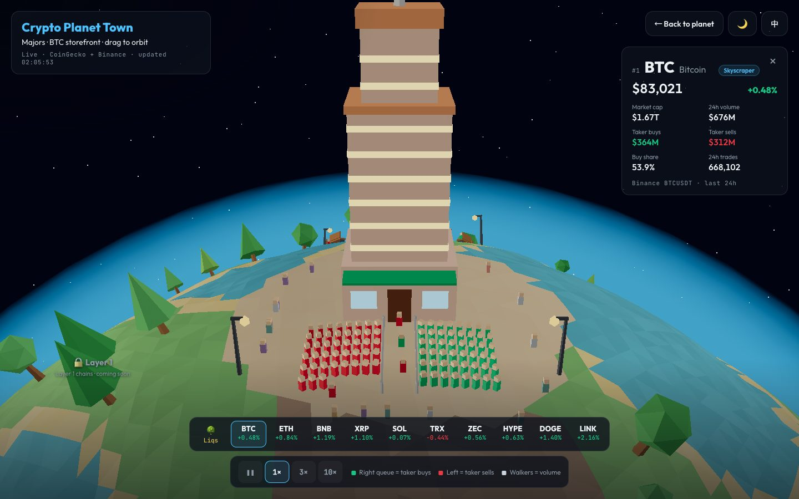
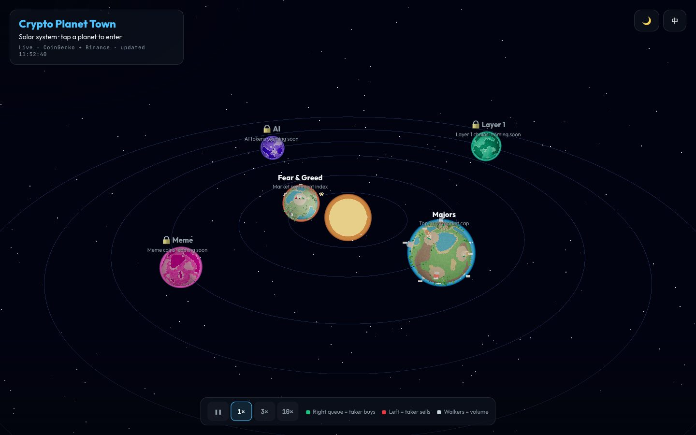
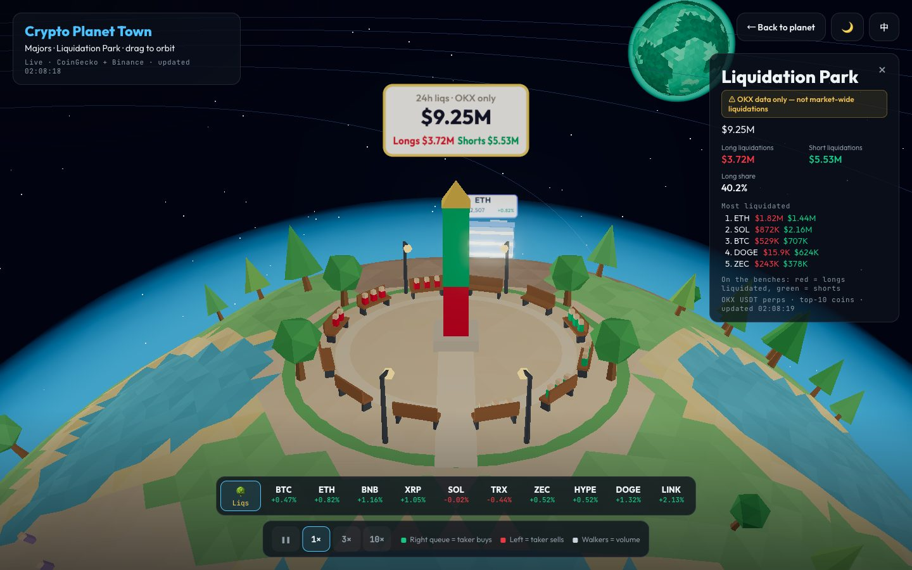
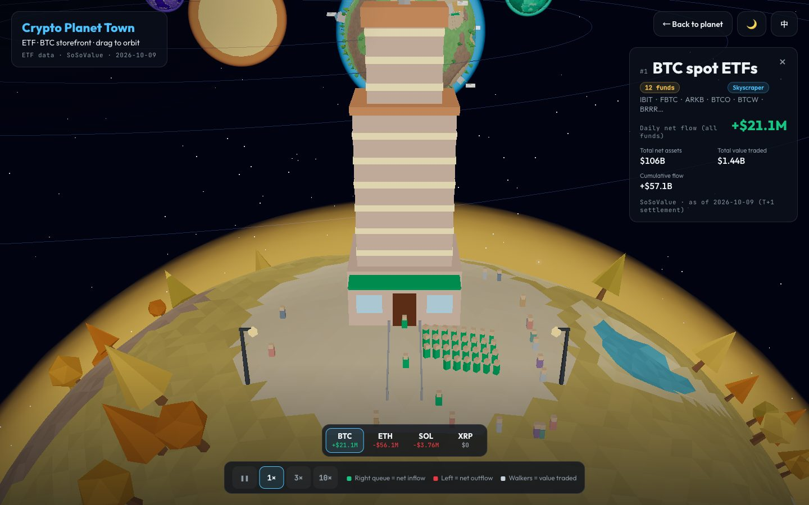
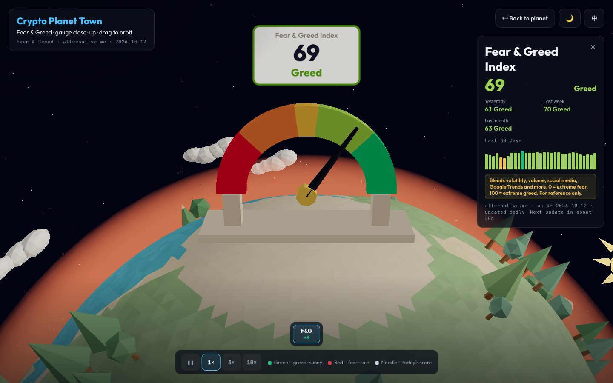
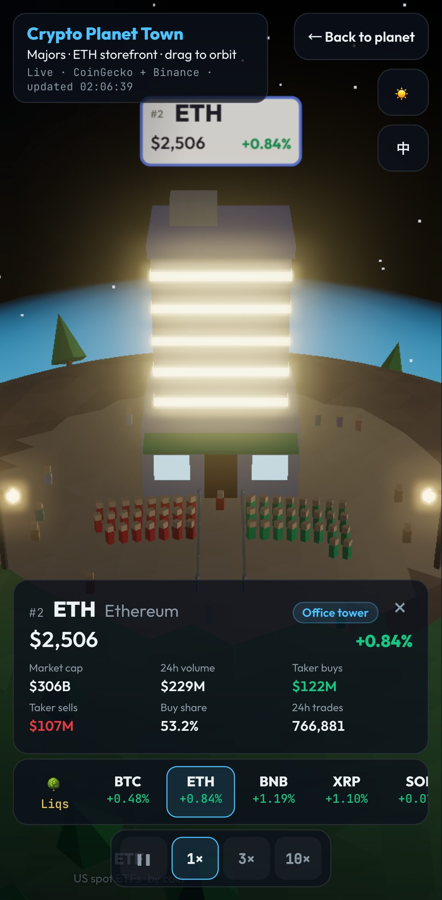

# Crypto Planet Town

**English** · [繁體中文](README.md)

The crypto market as a tiny low-poly solar system: **each sector is a planet, and each coin is a shop on it**. Long queues at the door and busy sidewalks show you at a glance where the money is moving.

**👉 [Open the site](https://pekkachiu.github.io/crypto-planet/?lang=en)** · works on mobile · English / 中文 toggle in the top-right corner

## How to read it

### 🪐 Solar system

Tap a planet to fly in. **Majors**, **ETF** and **Fear & Greed** are open now; Meme, AI and Layer 1 planets are coming soon.

### 🏙️ Majors: the top 10 coins

The top 10 coins by market cap (excluding stablecoins and wrapped tokens) each run a shop. Tap a shop, or a coin in the bottom bar, for the numbers.

| On screen | What it means |
|---|---|
| Building size | Market cap: ≥ $1T skyscraper, ≥ $100B office tower, ≥ $20B storefront, smaller ones are kiosks |
| Green queue on the right of the door | 24h taker buy volume |
| Red queue on the left of the door | 24h taker sell volume |
| People walking around | 24h trading volume |
| How fast the queue moves | 24h number of trades |
| Sign colour | 24h price change: **green up, red down** |

### 🌳 Liquidation Park

At the north pole of the Majors planet. The red part of the monument is long liquidations and the green part is short liquidations. People on the benches in red were liquidated longs and people in green were liquidated shorts; their number scales with the amount.

> ⚠️ **The Liquidation Park uses OKX data only**: USDT perpetuals for these ten coins over the last 24 hours. It is **not market-wide**, so the totals are much smaller than aggregate trackers such as Coinglass.

### 🏦 ETF planet: spot ETF fund flows

US spot crypto ETFs, with **one building per coin** (BTC, ETH, SOL, XRP). Each building adds up all of that coin's ETFs; the BTC building, for example, is IBIT + FBTC + GBTC + the rest.

| On screen | What it means |
|---|---|
| Building size | Total net assets: ≥ $50B skyscraper, ≥ $10B office tower, ≥ $1B storefront, smaller ones are kiosks |
| Green queue on the right | Total daily net inflow |
| Red queue on the left | Total daily net outflow (only one side ever has a queue) |
| People walking around | Total value traded |

Fund flows settle on a **T+1** basis, so the numbers are from the latest settled trading day. There is no new data on weekends or US market holidays.

### 🌦️ Fear & Greed planet: market sentiment

Shows the crypto **Fear & Greed Index**: 0 is extreme fear, 100 is extreme greed, and it updates once a day.

| What you see | What it means |
|---|---|
| The needle on the big gauge | Today's score, on a scale from red (fear) to green (greed) |
| Dark clouds and rain | Fear: the lower the score, the more clouds and the heavier the rain |
| The sun | Greed: the higher the score, the bigger the sun and the fewer the clouds |

Tap the gauge or F&G at the bottom to see yesterday's, last week's and last month's scores, plus the last 30 days.

### 🌙 Day and night · 📱 Mobile

Switch between day and night in the top-right corner; by default it follows your local time (day is 06:00–18:00). On phones the info cards become bottom drawers and the coin bar scrolls sideways.

## Data sources

| Source | Used for | Refresh |
|---|---|---|
| [CoinGecko](https://www.coingecko.com/) | Market cap, price, 24h change | Every 60 seconds |
| [Binance](https://www.binance.com/) | 24h volume, taker buys and sells, number of trades | Every 60 seconds |
| [OKX](https://www.okx.com/) | 24h liquidations in the Liquidation Park (OKX only) | Every 5 minutes |
| [SoSoValue](https://sosovalue.com/) | ETF fund flows, net assets, value traded | Twice a day |
| [Alternative.me](https://alternative.me/crypto/fear-and-greed-index/) | Fear & Greed Index | Once a day |

If live data can't be reached, the site falls back to bundled sample data and says so in the top-left corner.

> This site is a visualization for reference only and is **not financial advice**.

**Privacy**: page views are counted with [GoatCounter](https://www.goatcounter.com/), which uses no cookies and collects no personal data.

## Tech

A purely static site with no backend: Three.js (WebGL) and Vite, hosted on GitHub Pages. The ETF data needs an API key, so GitHub Actions fetches it twice a day and deploys it together with the site; the key never appears in the web page or the source code.
