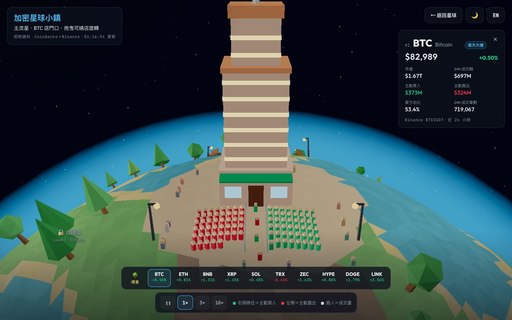
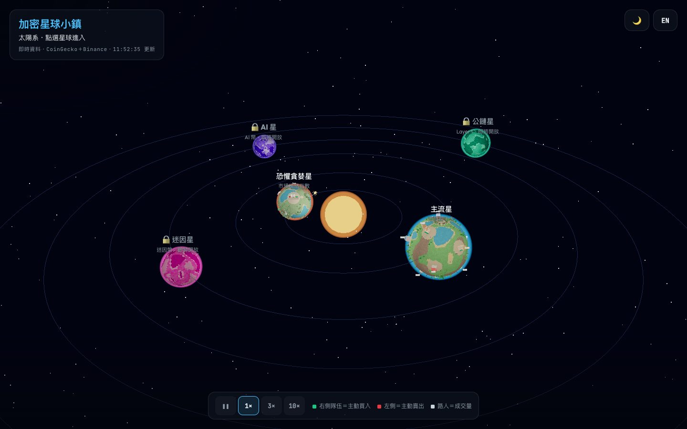
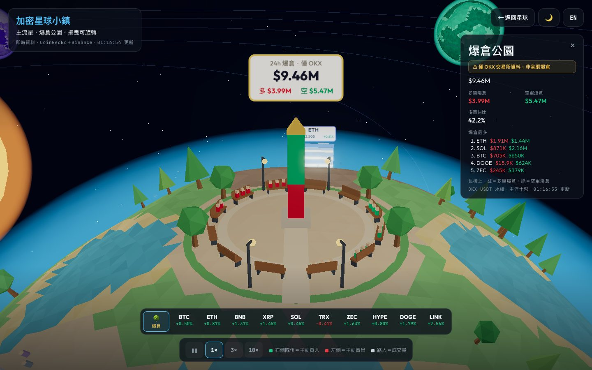
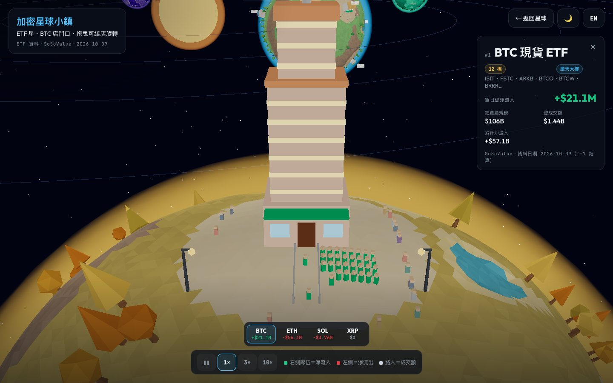
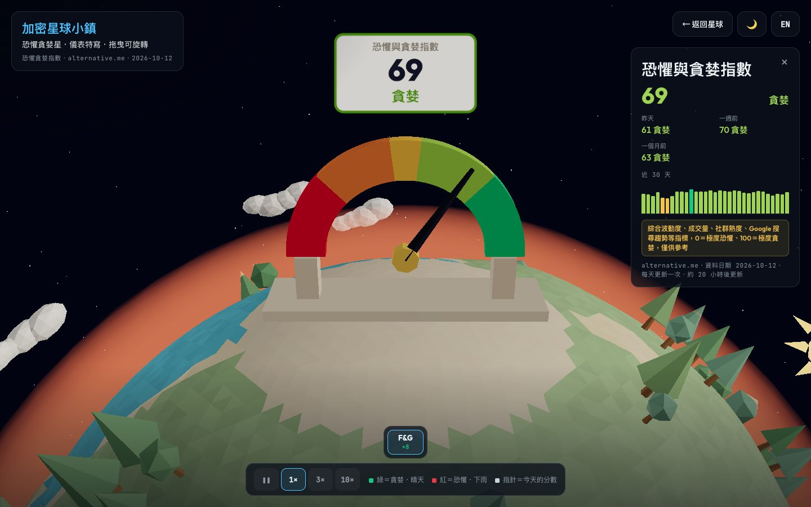
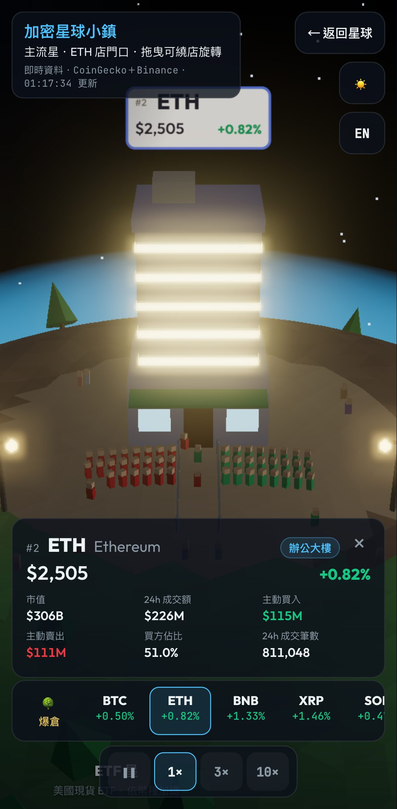

# 加密星球小鎮（Crypto Planet Town）

[English](README.en.md) · **繁體中文**

把加密貨幣市場畫成一個低多邊形的小太陽系：**每個分類是一顆星球，每個幣種是星球上的一間店**。哪家店門口排長隊、哪裡人潮最多，一眼就看得出市場的錢往哪裡跑。

**👉 [打開網站](https://pekkachiu.github.io/crypto-planet/)**　支援手機、中英文切換（右上角 EN／中）

## 怎麼看

### 🪐 太陽系

點一顆星球就會飛進去。目前開放 **主流星**、**ETF 星** 與 **恐懼貪婪星**，迷因、AI、公鏈星球即將開放。

### 🏙️ 主流星：市值前十大的幣

排除穩定幣與包裝幣後，市值前十大的幣種各開一間店。點店面或下方的幣種列，可以看到詳細數字。

| 畫面 | 代表什麼 |
|---|---|
| 建築大小 | 市值：≥ $1T 摩天大樓、≥ $100B 辦公大樓、≥ $20B 街邊店舖、其他小攤 |
| 門口右側的綠色隊伍 | 24 小時主動買入金額（Taker Buy） |
| 門口左側的紅色隊伍 | 24 小時主動賣出金額 |
| 路上的行人 | 24 小時成交額 |
| 叫號速度 | 24 小時成交筆數 |
| 招牌顏色 | 24 小時漲跌：**綠漲紅跌**（國際慣例） |

### 🌳 爆倉公園

位在主流星的北極。中央紀念碑的紅色段是多單爆倉、綠色段是空單爆倉；長椅上坐的紅衣人是多單爆倉者、綠衣人是空單爆倉者，人數隨金額增減。

> ⚠️ **爆倉公園只使用 OKX 一家交易所的資料**（這十個幣的 USDT 永續合約、過去 24 小時），**不是全網爆倉**，數字會比 Coinglass 等全網統計小很多。

### 🏦 ETF 星：現貨 ETF 的資金流

美國現貨加密貨幣 ETF，**一個幣種一棟**（BTC、ETH、SOL、XRP），每棟是該幣種所有 ETF 的加總，例如 BTC 棟＝IBIT、FBTC、GBTC…合計。

| 畫面 | 代表什麼 |
|---|---|
| 建築大小 | 總資產規模：≥ $50B 摩天大樓、≥ $10B 辦公大樓、≥ $1B 街邊店舖、其他小攤 |
| 右側綠色隊伍 | 單日總淨流入 |
| 左側紅色隊伍 | 單日總淨流出（流入與流出只會有一邊有人） |
| 路上的行人 | 總成交額 |

資金流是 **T+1 結算**，顯示的是最近一個已結算交易日的數字；週末與美股假日沒有新資料。

### 🌦️ 恐懼貪婪星：市場情緒

顯示加密貨幣的 **恐懼與貪婪指數（Fear & Greed Index）**：0 分是極度恐懼、100 分是極度貪婪，每天更新一次。

| 畫面 | 代表什麼 |
|---|---|
| 大儀表的指針 | 今天的分數，刻度由紅（恐懼）到綠（貪婪） |
| 烏雲與下雨 | 恐懼：分數越低，雲越多、雨越大 |
| 太陽 | 貪婪：分數越高，太陽越大、雲越少 |

點儀表或下方的 F&G 可以看到昨天、一週前、一個月前的分數，以及近 30 天的走勢。

### 🌙 白天與夜晚・📱 手機

右上角可以切換白天或夜晚，預設依你的當地時間（06:00–18:00 為白天）。手機上資訊卡會變成底部抽屜，下方的幣種列可以左右滑動。

## 資料來源

| 來源 | 用在哪裡 | 更新頻率 |
|---|---|---|
| [CoinGecko](https://www.coingecko.com/) | 市值、價格、24 小時漲跌 | 每 60 秒 |
| [Binance](https://www.binance.com/) | 24 小時成交額、主動買入／賣出、成交筆數 | 每 60 秒 |
| [OKX](https://www.okx.com/) | 爆倉公園的 24 小時爆倉（僅 OKX） | 每 5 分鐘 |
| [SoSoValue](https://sosovalue.com/) | ETF 資金流、資產規模、成交額 | 每天兩次 |
| [Alternative.me](https://alternative.me/crypto/fear-and-greed-index/) | 恐懼與貪婪指數 | 每天一次 |

即時資料暫時抓不到時會改用內建的範例資料，左上角會標示。

> 本網站僅供視覺化參考，**不構成任何投資建議**。

**隱私**：網站用 [GoatCounter](https://www.goatcounter.com/) 計算瀏覽人次，不使用 Cookie，也不收集任何個人資料。

## 技術

純靜態網站，沒有後端：Three.js（WebGL）、Vite，部署在 GitHub Pages。ETF 資料需要 API Key，由 GitHub Actions 每天抓好後跟網站一起部署，Key 不會出現在網頁或程式碼裡。
